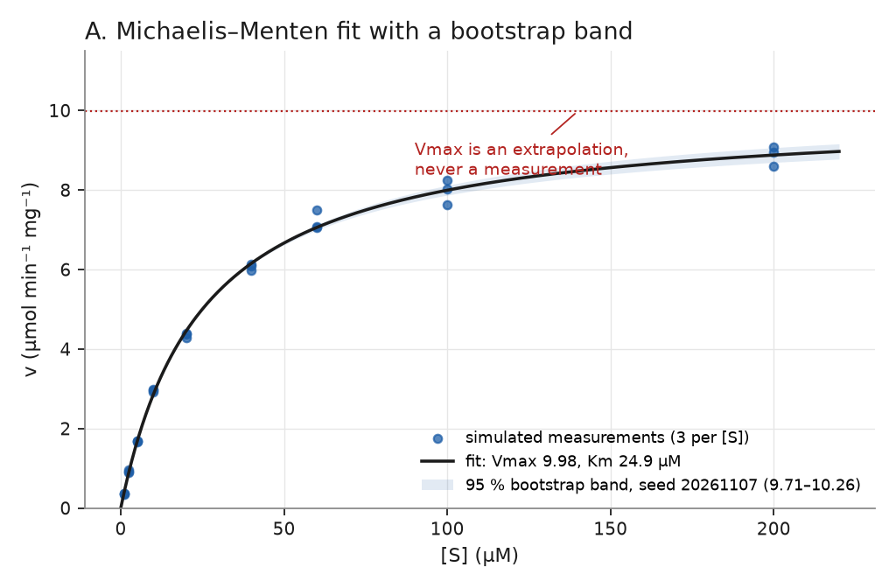
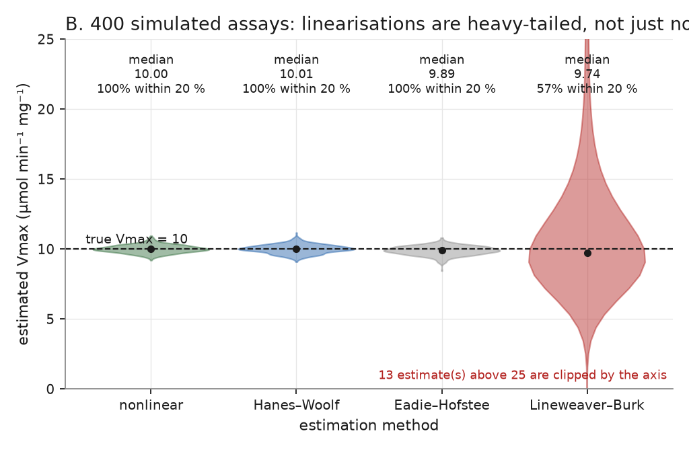

# Fitting Enzyme Kinetics Without Fooling Yourself

**CLS-Open repository 2 of 15 — the intermediate entry point, and the first one with real
numerical dependencies (`numpy`, `scipy`).**

Most kinetics teaching stops at "plot it and read the slope". This course starts where
that fails: the moment you have to decide *which* model, *which* weighting, *which*
uncertainty, and what to write down when the data cannot answer the question.

You will fit Michaelis–Menten curves to real-shaped data, watch the Lineweaver–Burk
transformation produce a 20 % error on a dataset that Michaelis–Menten fits to within
0.2 %, compare inhibition mechanisms with AICc, and report a detection limit that changes
by a factor of 58 depending on a weighting decision you did not know you were making.

Every number in this course comes from executed code. Where a claim is a measurement —
"the linearisation is biased" — the repository contains the code that measured it, the
figure that shows the distribution, and the test that fails if the claim stops being true.

## Start here

1. **[Installation](installation.md)** — about 10 minutes, ends with `kinetics --version`
   printing `kinetics 0.1.0`.
2. **[Prerequisites](prerequisites.md)** — what you need to know, and what you do not.
3. **[Learning path](learning_path.md)** — the order, the time budget, and where to stop
   if you only have a weekend.
4. **[Module 1](modules/01-units-rates-and-what-an-assay-measures.md)** — units, rates and
   what an assay actually measures.

## What is here

| Section | What it is |
|---|---|
| [Modules](modules/01-units-rates-and-what-an-assay-measures.md) | Six complete lessons, each with worked, executed examples |
| [Practicals](practicals/practical-01-first-michaelis-menten-fit.md) | Five guided sessions with rubrics |
| [Assessments](assessments/assignment-01-fitting-decisions.md) | An assignment and two challenges with rubrics, plus a 16-question quiz with a full answer key |
| [Projects](https://github.com/cls-open/python-for-biochemists/blob/main/projects/mini_projects/README.md) | Two mini-projects and a capstone |
| [Instructor pack](instructor/index.md) | Delivery plans, timings, misconceptions, marking scheme |
| [Validation](validation.md) | Exactly what has been checked, and against what |
| [Limitations](limitations.md) | What this repository does **not** do — including what it cannot tell you |
| [References](references.md) | Every citation, DOI-verified against Crossref |
| [Roadmap](roadmap.md) | What comes after this repository |

## Figures

*Figure 1 — The Michaelis–Menten fit to `datasets/sample/michaelis_menten.csv` (27
measurements, 9 substrate concentrations, three replicates each). The fit gives
Vmax = 9.98 ± 0.11, Km = 24.88 ± 0.84 µM (R² = 0.99742), against simulated truth of 10.0
and 25.0 µM. The band is a 95 % percentile bootstrap with seed 20261107, which gives
9.71–10.26 for Vmax. Vmax is an extrapolation: nothing in the data was measured at
infinite substrate. Reproduce with `python scripts/make_figures.py`; the numbers are also
in `figures/figure_values.json`.*

*Figure 2 — 400 simulated assays with 3 % proportional plus 0.05 absolute noise, fitted
four ways. The median Lineweaver–Burk estimate is close to the truth (9.74 against 10.0),
which is why "it looks fine on my dataset" proves nothing: what changes is the tail. Only
57 % of Lineweaver–Burk estimates land within 20 % of the truth, against 100 % for the
nonlinear fit, and its estimates reach beyond 25 µmol min⁻¹ mg⁻¹ where the true value is
10. Module 3 is about why, and Module 4 is about what to do instead.*

## What makes this repository different

* **The bias is demonstrated, not asserted.** `tests/test_linearisation.py` runs 300
  seeded assays and asserts that Lineweaver–Burk fails catastrophically (more than 100 %
  error) in 30 % of them at σ = 0.10, while the nonlinear fit fails in none.
* **The negative result is included.** `datasets/sample/inhibition_weak.csv` is a real
  competitive inhibitor measured with a badly designed experiment: the fit reports
  "indistinguishable models", names a mechanism that is *not* the true one, and explains
  why. Learning to write that down is the point of Module 6.
* **Nothing is silently fixed.** No silent row filtering, no silent unit conversion, no
  silent fallback to a different optimiser. The exits are loud on purpose
  (`docs/limitations.md` lists the consequences).
